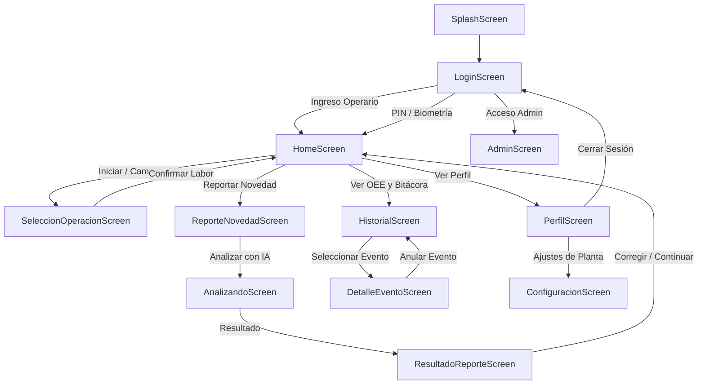

# 🏭 BRIX360 (SuperBrix) — Tu Aliado en la Planta

[-3DDC84?logo=android&logoColor=white)](https://developer.android.com/)
[](https://kotlinlang.org/)
[](https://developer.android.com/jetpack/compose)
[](https://junit.org/)
[]()

**BRIX360** es la solución móvil industrial desarrollada para **SuperBrix**, orientada al **control operativo en piso de planta, registro inteligente de novedades con Inteligencia Artificial, cálculo en tiempo real de tiempos muertos (OEE) y priorización absoluta de Salud y Seguridad Ocupacional**.

La aplicación opera bajo arquitectura **Offline-First**, permitiendo a los operarios registrar eventos, pausas, setups y novedades por dictado de voz o texto, manteniéndose 100% funcional sin conexión a internet y sincronizando automáticamente con Google Sheets y tableros en Google Looker Studio al recuperar señal.

---

## 📑 Tabla de Contenidos

1. [¿De qué se trata BRIX360?](#-de-qué-se-trata-brix360)
2. [Credenciales y Accesos del Sistema](#-credenciales-y-accesos-del-sistema)
3. [Pantallas y Flujo Operativo](#-pantallas-y-flujo-operativo-12-pantallas)
4. [Matriz de las 8 Categorías de IA](#-matriz-de-las-8-categorías-de-ia)
5. [Arquitectura Técnica y Sincronización](#-arquitectura-técnica-y-sincronización-offline-first)
6. [Integraciones Externas (Google Sheets & Looker Studio)](#-integraciones-externas)
7. [Guía de Compilación e Instalación](#-guía-de-compilación-e-instalación)
8. [Estructura del Proyecto](#-estructura-del-proyecto)

---

## 🎯 ¿De qué se trata BRIX360?

En los entornos industriales de manufactura de SuperBrix (mecanizado CNC, soldadura, ensamble y pintura), la captura oportuna de las causas de parada de máquina suele perderse o registrarse tardíamente en papel.

**BRIX360 resuelve esto en piso de planta:**
- **Inicio y Monitoreo de Labor:** Cronómetro tabular en vivo legible a distancia, mostrando Orden de Producción (OP), Centro de Trabajo, Máquina y Área.
- **Reporte Rápido de Novedades (Glove-Friendly):** Botones grandes de 56–64 dp accionables con guantes de seguridad, dictado por voz industrial con onda de pulso y captura de evidencia fotográfica.
- **Clasificación Automática con IA:** Interpreta lenguaje natural de planta (ej. *"se recalentó el husillo y se rompió la banda"* o *"me corté un dedo"*), categorizando de inmediato en una de las 8 categorías oficiales.
- **Prioridad Vital a Salud y Seguridad:** Si un operario reporta una lesión, caída o derrame químico, la app emite una **Alerta de Planta de Alta Prioridad** instantánea en el dispositivo y destaca el evento en rojo crítico.
- **Trazabilidad y Auditoría:** Permite al operario corregir la categoría antes o después de guardar, y anular eventos bajo motivo justificado sin alterar la integridad histórica.

---

## 🔑 Credenciales y Accesos del Sistema

Para realizar pruebas y operación en planta, utiliza las siguientes credenciales y perfiles precargados:

### 1. 👷 Operarios Registrados (Selector de Perfil en Login)
Al ingresar a la app en `LoginScreen`, selecciona directamente cualquiera de los operarios activos o escribe su código en el buscador:

| Operario | Código | Área de Planta | Centro de Trabajo | Rol |
| :--- | :---: | :---: | :---: | :--- |
| **Juan Pérez** | `COD-100` | CNC | CT-Mecanizado | Operario CNC |
| **Sara Gómez** | `COD-101` | Ensamble 1 | CT-Soldadura | Operaria Ensamble |
| **Carlos Mendoza** | `COD-102` | Pintura | CT-Pintura | Operario Pintura |

> **Acceso Biométrico Nativo:** Puedes presionar el botón **"Huella o rostro"** para ingresar utilizando la biometría registrada en el dispositivo físico.

---

### 2. 🦺 PIN de Supervisor (Cambio de Área / Operación Restringida)
Al intentar cambiar manualmente el área asignada de manufactura en `SeleccionOperacionScreen`, la aplicación exige autorización:

* **PIN de Supervisor por Defecto:** `1234`
* **PIN de Contingencia:** `superbrix`
* **Seguridad:** Validado mediante hash criptográfico SHA-256 (`03ac6742...`). No se compara en texto plano.

---

### 3. 🛡️ Panel de Administración (Gestión de Operarios y Enlaces)
Para acceder al panel de administración de planta:
1. En la pantalla de **Login**, presiona el **ícono de candado / admin** ubicado en la esquina superior derecha.
2. Ingresa la contraseña administrativa:
   * **Contraseña Principal:** `superbrix2026`
   * **Contraseña de Transición:** `admin123`
3. **Capacidades del Administrador:**
   * Crear nuevos operarios con validación estricta de código único.
   * Editar nombres, códigos y áreas de trabajo.
   * Eliminar operarios con diálogo de confirmación industrial.
   * Acceso directo con un toque a la **Base de Datos en Google Sheets** y al **Dashboard en Looker Studio**.

---

## 📱 Pantallas y Flujo Operativo (12 Pantallas)



1. **`SplashScreen`:** Presentación sobria con cubo BRIX360 3D, fade/scale animado y eslogan oficial.
2. **`LoginScreen`:** Selector rápido de operario, buscador reactivo, botón biométrico nativo y acceso administrativo discreto.
3. **`HomeScreen`:** Centro de control operativo con `StatusCard` (cronómetro tabular en vivo con animación de pulso), `OperationCard` (matriz 2x2 de OP, Máquina, Área y Operación) y botón dinámico de 64 dp con confirmación de finalización de labor.
4. **`SeleccionOperacionScreen`:** Stepper guiado (Paso 1: OP, Paso 2: Área, Paso 3: Operación, Paso 4: Máquina) con validación de PIN de supervisor para cambios de área.
5. **`ReporteNovedadScreen`:** Dictado por voz con onda pulsante, chips de acceso rápido a novedades comunes, adjunto de fotografía con preview y botón fijo inferior.
6. **`AnalizandoScreen`:** Animación técnica del cubo industrial, temporizador de timeout de 10 segundos con alternativas de reintento o guardado local offline.
7. **`ResultadoReporteScreen`:** Banner de alerta roja inmediata ante eventos de Salud y Seguridad, chip interactivo para corregir la categoría antes de archivar y barra de certeza de IA.
8. **`HistorialScreen`:** Métricas OEE (Órdenes, Producción Activa, Tiempo Muerto), filtros por chips de categoría y exportación de bitácora a CSV mediante Intent nativo.
9. **`DetalleEventoScreen`:** Trazabilidad completa (cronología, foto adjunta, badges de sincronización) y función de anulación bajo motivo obligatorio.
10. **`PerfilScreen`:** Ficha operativa del trabajador, acceso a configuración y cierre de sesión seguro con purga del stack de navegación.
11. **`ConfiguracionScreen`:** Monitor de red en tiempo real (WiFi / Ethernet de planta), persistencia DataStore (tema oscuro, notificaciones de emergencia, dictado), contador de cola pendiente y sincronización forzada.
12. **`AdminScreen`:** Administración del catálogo de operarios (alta, modificación y eliminación con validación de código único y área de manufactura).

---

## 🧠 Matriz de las 8 Categorías de IA

BRIX360 clasifica de forma estricta y determinista en las **8 categorías maestras de SuperBrix**:

| # | Categoría Oficial | Color de Estado | Criterio Industrial |
| :-: | :--- | :---: | :--- |
| **1** | **Salud y Seguridad (Accidentes)** | 🔴 `#E63946` | **Prioridad Máxima Absoluta.** Lesiones, cortes, caídas, quemaduras, conatos de incendio, derrames químicos o emergencias humanas. Dispara alerta sonora/vibratoria de planta. |
| **2** | **Alistamiento y Preparación (Setup)** | 🔵 `#00C2FF` | Montaje de mordazas, calibración de cero pieza, cambio de herramientas, preparación de máquina previa al ciclo. |
| **3** | **Calidad y Aprobación** | 🟣 `#7C3AED` | Piezas fuera de tolerancia, rechazos por metrología, inspección de primera pieza, rayones o defectos visuales. |
| **4** | **Falla Técnica / Mantenimiento** | 🟠 `#FF8A00` | Averías mecánicas, rotura de bandas, sobrecalentamiento de husillo/motor, fugas hidráulicas, cortocircuitos o alarmas CNC. |
| **5** | **Espera de Materiales / Logística** | 🟡 `#F39C12` | Falta de materia prima (láminas, perfiles, pernos), espera de montacargas, retiro de viruta o refrigerante. |
| **6** | **Instrucciones / Coordinación** | 🔵 `#3B82F6` | Charlas de 5 minutos, espera de autorización de supervisor, aclaración de dudas en planos de ingeniería, relevo de turno. |
| **7** | **Producción Activa** | 🟢 `#1DB954` | Ciclo regular de mecanizado, soldadura, armado o pintura en ritmo normal. |
| **8** | **Otros / Novedad Excepcional** | ⚪ `#94A3B8` | Cortes de energía externa, fallas generales de suministro, pausas activas o eventos no técnicos. |

---

## 💾 Arquitectura Técnica y Sincronización Offline-First

```text
[ Pantallas Compose (Material 3) ]
             ▲
             │ StateFlow & Coroutines
             ▼
[ ViewModels (HomeViewModel & EventoViewModel) ]
             ▲
             │ Inserción inmediata
             ▼
[ Repositorios (EventoRepository & OperarioRepository) ]
             │
      ┌──────┴─────────────────────────┐
      ▼                                ▼
[ SQLite Local (BrixDatabaseHelper) ] [ WorkManager (SyncWorker) ]
(Almacenamiento persistente)           (Background Sync cada 15m y reactivo)
                                       │
                                ┌──────┴─────────────────────────┐
                                ▼                                ▼
                 [ Google Apps Script Webhook ]          [ Backend FastAPI ]
                 (Persistencia Google Sheets)            (Inferencia IA Gemini)
```

1. **Persistencia Inmediata en SQLite:** Todo reporte o evento se guarda localmente en milisegundos en [BrixDatabaseHelper.kt](file:///c:/Users/sarit/SuperBrixIA/app/src/main/java/com/superbrix/ia/data/local/db/BrixDatabaseHelper.kt) con estado `PENDIENTE`.
2. **SyncWorker (WorkManager):** Se activa cada 15 minutos cuando hay conectividad a internet (`NetworkType.CONNECTED`) y reactivamente tras cada evento reportado. Al sincronizar con éxito, actualiza el estado a `ENVIADO`.
3. **FallbackClassifier:** Si no hay internet o el backend excede 10 segundos de timeout, el clasificador local de contingencia en [FallbackClassifier.kt](file:///c:/Users/sarit/SuperBrixIA/app/src/main/java/com/superbrix/ia/core/ai/FallbackClassifier.kt) normaliza tildes y clasifica de forma inmediata y determinista en el teléfono.

---

## 🌐 Integraciones Externas

Los enlaces de producción están centralizados en la configuración del proyecto y son accesibles desde el panel de administración de la app:

* 📊 **Base de Datos en Vivo (Google Sheets):**  
  [Ver Hoja de Cálculo de Eventos](https://docs.google.com/spreadsheets/d/1okZRQ37KSMZ497iIltWPRjC7SrxYiLPc5iT28I3QXEo/edit?usp=sharing)
* 📈 **Dashboard Ejecutivo OEE (Google Looker Studio):**  
  [Ver Dashboard de Control en Planta](https://datastudio.google.com/reporting/7917f5be-a89a-40a1-87a4-aef50f1b42f8)
* ⚡ **Webhook Google Apps Script:**  
  `https://script.google.com/macros/s/AKfycbyEP7gj1XO2Wysa-0gVJLH46w-OH5vEnzGp6wspTzi2GKR2G18UhfB44SilHQQwTym_/exec`

---

## 🛠️ Guía de Compilación e Instalación

### Requisitos Previos:
- **Android Studio Ladybug (2024.2+)** o superior.
- **JDK 17** o **JDK 21** configurado.
- **Android SDK:** `minSdk = 24` (Android 7.0), `targetSdk = 36` (Android 16).

### 1. Compilación de la Aplicación (Gradle):
```powershell
# Clonar el repositorio
git clone https://github.com/cervantessaralucia4-dotcom/SuperBrixIA.git
cd SuperBrixIA

# Ejecutar suite de pruebas unitarias (14/14)
.\gradlew.bat testDebugUnitTest

# Generar APK de depuración / prueba
.\gradlew.bat assembleDebug

# O generar APK optimizada para distribución
.\gradlew.bat assembleRelease
```

### 2. Instalación en Dispositivo o Emulador:
El archivo APK listo para pruebas se encuentra generado en la raíz del proyecto o en la carpeta de build:
* **APK Raíz:** `BRIX360-v2.0-industrial.apk`
* **Instalación vía ADB:**
  ```powershell
  adb install -r BRIX360-v2.0-industrial.apk
  ```

---

## 📁 Estructura del Proyecto

```text
SuperBrixIA/
│
├── app/                                 # Módulo principal Android (Compose M3)
│   ├── src/main/java/com/superbrix/ia/
│   │   ├── core/                        # Núcleo de seguridad, IA y notificaciones
│   │   │   ├── ai/                      # FallbackClassifier y modelos de clasificación
│   │   │   ├── config/                  # AppConfig y constantes seguras
│   │   │   ├── network/                 # NetworkMonitor para estado de red
│   │   │   ├── notifications/           # PlantNotificationHelper (canal de emergencias)
│   │   │   └── security/                # SecurityUtils (hashes SHA-256)
│   │   ├── data/
│   │   │   ├── local/                   # PreferencesManager (DataStore) y BrixDatabaseHelper (SQLite)
│   │   │   ├── model/                   # Modelos de datos (Evento, Operario, Máquina, OP)
│   │   │   ├── remote/                  # SuperBrixApiClient (Retrofit + OkHttp) y DTOs
│   │   │   ├── repository/              # EventoRepository y OperarioRepository
│   │   │   └── sync/                    # SyncWorker (WorkManager en background)
│   │   ├── navigation/                  # AppNavigation y definición de NavRoutes
│   │   ├── ui/
│   │   │   ├── components/              # Componentes industriales (Buttons, StatusCard, etc.)
│   │   │   ├── screens/                 # Las 12 pantallas de la aplicación
│   │   │   └── theme/                   # Color, Shape, Theme y Type (Inter local)
│   │   ├── viewmodel/                   # HomeViewModel y EventoViewModel
│   │   ├── MainActivity.kt              # Actividad principal con FragmentActivity
│   │   └── SuperBrixApp.kt              # Application class con WorkManager y Notificaciones
│   ├── src/main/res/font/               # Fuente oficial Inter descargada localmente
│   └── src/test/java/com/superbrix/ia/  # Pruebas unitarias de seguridad y clasificador
│
├── backend/                             # API REST en FastAPI opcional para inferencia y proxy
│   └── app/                             # Endpoints /ia/clasificar y /eventos/
│
├── BRIX360-v2.0-industrial.apk          # APK compilada y lista para probar
├── CHANGELOG.md                         # Historial detallado de versiones y cambios
└── README.md                            # Documentación integral de BRIX360
```

---

*Desarrollado con dedicación técnica para la excelencia operativa de **SuperBrix** — "Tu aliado en la planta".*
